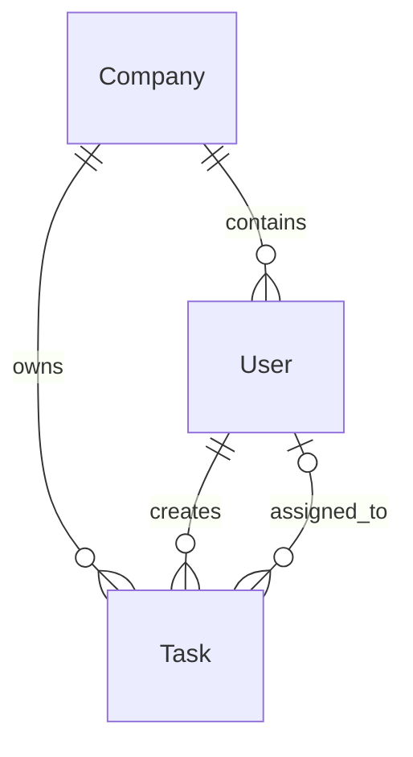

# Model domenowy

## Encje

- **Company** reprezentuje tenant, czyli jedną niezależną agencję. Ma UUID, nazwę oraz daty utworzenia i aktualizacji.
- **User** reprezentuje osobę należącą do dokładnie jednej firmy. Zawiera imię, nazwisko, e-mail, hash hasła, rolę, stan aktywności i daty. `isActive = false` dezaktywuje konto bez kasowania powiązanej historii.
- **Task** należy do jednej firmy i ma tytuł, opcjonalny opis, status, twórcę, opcjonalnie przypisanego agenta, opcjonalny termin oraz daty. Priorytety, komentarze, załączniki i historia zmian pozostają przyszłymi rozszerzeniami.

Publiczne typy z `packages/shared-types` są niezależne od Prisma. Kontrakt `User` nie zawiera `passwordHash`; pole to jest wyłącznie szczegółem przechowywania backendu.

## Relacje

| Relacja | Znaczenie |
| --- | --- |
| Company → User | Firma ma użytkowników; każdy użytkownik ma dokładnie jedną firmę. |
| Company → Task | Firma ma zadania; każde zadanie należy do dokładnie jednej firmy. |
| User → Task (creator) | Każde zadanie ma jednego twórcę. |
| User → Task (assignee) | Zadanie może nie mieć przypisanego użytkownika; przypisanie wskazuje najwyżej jednego agenta. |

## Multi-tenancy

Każdy rekord User i Task przechowuje `companyId`. Para `(id, companyId)` w User ma ograniczenie unikalności, a relacje Task do twórcy i przypisanego użytkownika odwołują się do tej pary. Dzięki temu klucz obcy na poziomie PostgreSQL nie pozwala przypiąć zadania firmy A do użytkownika firmy B.

Unikalność e-maila jest ograniczona do `(companyId, email)`. Zapis e-maila musi być kanonizowany do małych liter przez walidację/warstwę domenową przed zapisem. Wszystkie zapytania i uprawnienia muszą dodatkowo zawierać zakres `companyId`; UUID nie jest mechanizmem autoryzacji.

Relacje używają `onDelete: Restrict`. Użytkowników należy dezaktywować zamiast usuwać, a firma i użytkownik z historią zadań nie mogą zostać usunięci kaskadowo. Zmiana `updatedAt` jest obsługiwana przez Prisma przy aktualizacji rekordu.

## Prisma

Schemat znajduje się w `apps/api/prisma/schema.prisma`. Projekt używa zainstalowanego Prisma ORM 7.10.1: generator `prisma-client` ma jawne `output`, a URL źródła danych jest w `apps/api/prisma7.config.ts`, zgodnie z formatem tej wersji. Plik `.env.example` nie jest automatycznie ładowany jako środowisko; polecenia wymagające bazy potrzebują ustawionego `DATABASE_URL`. Na tym etapie nie wygenerowano klienta ani nie wykonano migracji.
